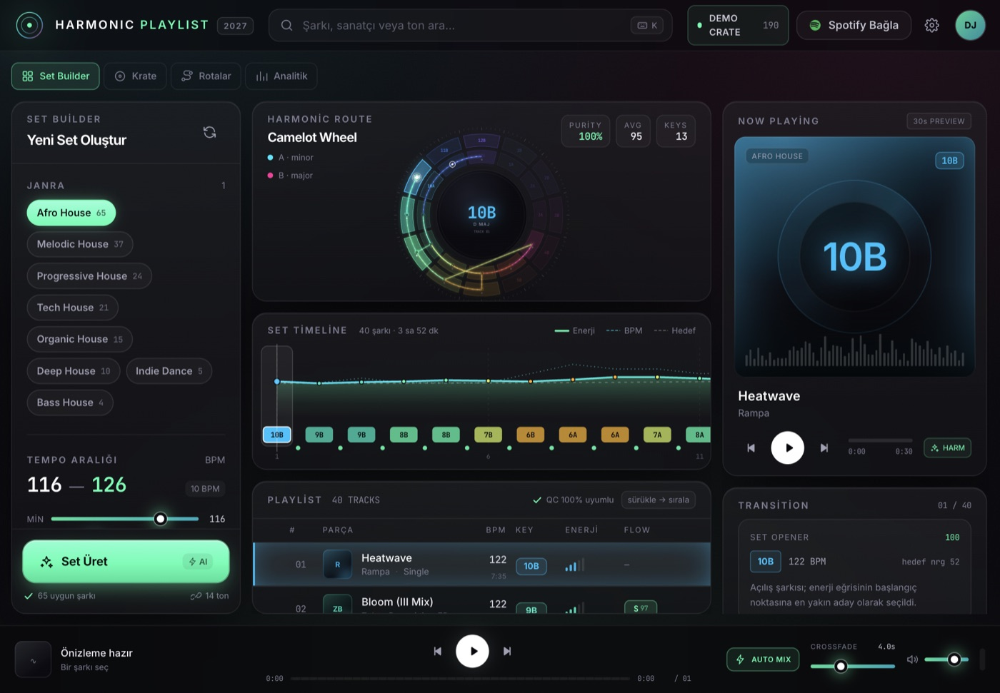

# Harmonic Playlist

**Camelot farkındalıklı, enerji profilli DJ set üreticisi.**
Spotify kütüphanesini (veya yerleşik demo krate'ini) analiz eder; tonal olarak uyumlu, BPM'i kontrol altında ve seçtiğin akış profiline göre şekillenen bir set üretir.



---

## Ne yapar?

| Yetenek | Nasıl çalışır? |
| --- | --- |
| **Camelot dönüşümü** | Spotify `key` (0–11) + `mode` (0/1) → 24 anahtarlı Camelot haritası. `8A = A min`, `8B = C maj`. |
| **Harmonik geçiş motoru** | Aynı ton, ±1 komşu, relatif majör/minör, ±2 enerji kayması ve diyagonal hareketler puanlanır; yarım ton çakışması sert şekilde reddedilir. |
| **BPM eşleştirme** | Half-time / double-time katlama, pitch yüzdesi ve uyumluluk eşiği. |
| **Enerji profilleri** | Steady Climb, Wave, Peak Time, Warm-up, Sunrise. Hedef eğri, krate'in gerçek enerji penceresine (p8–p92) yeniden ölçeklenir. |
| **Set üretimi** | Deterministik beam search (genişlik 18). Aynı tohum + aynı krate = aynı set. |
| **Köprü şarkılar** | Sert geçişlerde 1–2 şarkılık "bridge" önerisi; toplam ekleme 2 ile sınırlı. |
| **Etkileşimli UI** | 3D Camelot çarkı, enerji/BPM zaman çizelgesi, sürükle-bırak sıralama, anlık geçiş rozetleri, QC raporu. |
| **Krate ekranı** | 190 parçalık havuzun tamamı: janra/anahtar filtresi, tür dağılımı, sıralama, sete ekleme. Hangi şarkının neden seçilmediği görünür. |
| **Harmonik Rotalar** | Aynı krateden 5 farklı geçerli set (farklı tohum / sertlik / profil) üretilir; saflık, ortalama geçiş ve enerji doğruluğuna göre karşılaştırılır, tek tıkla aktif set olur. |
| **Analitik** | Geçiş not dağılımı, ton histogramı, BPM histogramı, enerji sapması, sanatçı tekrarı, veri kaynakları ve sorunlu geçiş listesi. |
| **Önizleme** | Spotify 30 sn MP3'ü Web Audio ile çalar; gerçek gain-ramp crossfade uygular. Demo şarkılarda anahtar + BPM'e senkron synth pad çalar. |
| **Spotify** | PKCE OAuth, token yenileme, 401/429 yönetimi, arama önbelleği, çalma listesi yayınlama. |
| **Çalma listesi içe aktarma** | Hesabındaki çalma listelerini listeler; seçileni 300 parçaya kadar krate olarak yükler (yerel dosya/podcast satırları atlanır). Yeni oturumda `playlist-read-private` izni istenir. |
| **Masaüstü** | Tauri 2: macOS `.dmg`, Windows `.exe`/`.msi`, loopback OAuth (sistem tarayıcısı + `127.0.0.1:8888`), native pencere. |

Demo modu **kimlik bilgisi gerektirmez**: uygulama ilk açılışta 190 prosedürel şarkıdan (65'i Afro House) 40 şarkılık bir set üretir. Aynı tohum (`0x2027`) sayesinde herkes aynı demo krate'ini görür.

---

## Hızlı başlangıç

```bash
# Node 20+ önerilir
npm install
npm run dev
```

Aç: **http://127.0.0.1:5199**

İlk açılışta set otomatik üretilir. `⌘/Ctrl + Enter` yeni bir set üretir, şarkıya tıklayınca çark ve geçiş paneli güncellenir, satırları sürükleyerek sıralamayı değiştirebilirsin.

### Spotify'a bağlanma (opsiyonel)

1. [Spotify Developer Dashboard](https://developer.spotify.com/dashboard) üzerinde uygulama oluştur.
2. **Redirect URI** olarak tam olarak şunu ekle:
   `http://127.0.0.1:5199/auth/callback`
3. `.env.example` dosyasını `.env` olarak kopyala ve doldur:

```env
VITE_SPOTIFY_CLIENT_ID=xxxxxxxxxxxxxxxxxxxxxxxx
VITE_SPOTIFY_REDIRECT_URI=http://127.0.0.1:5199/auth/callback
# Opsiyonel: ses özellikleri için alternatif sağlayıcı
VITE_RECCOBEATS_BASE_URL=https://api.reccobeats.com/v1
```

4. Dev sunucusunu yeniden başlat, sağ üstteki **Spotify Bağla** düğmesini kullan.

> **`localhost` kullanma:** Spotify, Nisan 2025'ten beri `http://localhost` biçimindeki redirect URI'leri reddediyor ve dashboard'da **"This redirect URI is not secure"** hatası veriyor. Loopback IP literal kullan: `http://127.0.0.1:5199/auth/callback`. Uygulamayı da **http://127.0.0.1:5199** üzerinden aç; PKCE doğrulayıcısı origin'e bağlı olduğu için `localhost` ile `127.0.0.1` arasında geçiş yaparsan giriş tamamlanmaz. HTTPS tüneli (ngrok/cloudflared) kullanıyorsan redirect URI da aynı `https://…` origin'i olmalı.

### Cloudflare Tunnel ile HTTPS redirect

Evet, `cloudflared` çalışır: Spotify HTTPS gördüğü için kabul eder. Tünel URL'si her başlatmada değişen **quick tunnel** yerine, mümkünse sabit bir **named tunnel + kendi domainini** kullan.

```bash
# 1) Uygulamayı loopback'te çalıştır
npm run dev

# 2) Ayrı terminalde tüneli aç
cloudflared tunnel --url http://127.0.0.1:5199
# Örnek çıktı: https://tiny-forest-1234.trycloudflare.com
```

`.env` içine tünelin **tam** callback adresini yaz ve dev sunucusunu yeniden başlat:

```env
VITE_SPOTIFY_REDIRECT_URI=https://tiny-forest-1234.trycloudflare.com/auth/callback
```

Aynı adresi Spotify Dashboard → **Redirect URIs** listesine ekle. Uygulamayı da `http://127.0.0.1:5199` yerine **tünel URL'sinden** aç. Quick tunnel her yeniden başlatmada yeni URL üretir; dashboard ve `.env` de o zaman güncellenmelidir.

Sabit adres için:

```bash
cloudflared tunnel create harmonic-playlist
cloudflared tunnel route dns harmonic-playlist harmonic-playlist.example.com
cloudflared tunnel run --url http://127.0.0.1:5199 harmonic-playlist
# Redirect: https://harmonic-playlist.example.com/auth/callback
```

> Tünel, dev sunucusunu internete açar. Vite dev sunucusu üretim için sertleştirilmemiştir; paylaşacaksan `npm run build && npm run preview` veya statik bir hosting kullan. Cloudflare Access ekliyorsan Spotify'ın erişebilmesi için `/auth/callback` yolunu **bypass** etmen gerekir (Spotify Access login ekranını geçemez).

### Başka bilgisayardan kullanım

Üç ayrı senaryo var; doğru olanı seç:

| Senaryo | Nasıl çalışır? | Redirect URI |
| --- | --- | --- |
| **Herkes kendi bilgisayarında** (önerilen, masaüstü) | Her kullanıcı uygulamayı kendi makinesinde çalıştırır, kendi Spotify hesabıyla giriş yapar. Sunucu/tünel gerekmez. | `http://127.0.0.1:PORT/auth/callback` — loopback her kullanıcının kendi makinesine gider. |
| **Tek makine + tünel** | Uygulama bir makinede çalışır; diğer bilgisayarlar tünel URL'sini açar. Herkes kendi Spotify hesabıyla giriş yapar. O makine açık kalmalı. | `https://<tunnel-domain>/auth/callback` |
| **Merkezi web deploy** (ölçeklenebilir) | `npm run build` çıktısı Cloudflare Pages / Vercel / Netlify'a yüklenir. Her kullanıcı aynı adresi açar, kendi hesabıyla giriş yapar. | `https://app.example.com/auth/callback` |

Önemli noktalar:

- **Loopback redirect merkezi deploy'da çalışmaz.** Kullanıcı `app.example.com`'u açsa bile OAuth callback `127.0.0.1`'e gider; bu, kullanıcının kendi makinesidir, sunucu değil. Merkezi deploy'da mutlaka public HTTPS redirect kullan.
- **LAN adresi (`http://192.168.x.x:5199`) Spotify tarafından reddedilir.** HTTPS değil ve loopback değil. Aynı ağdaki başka bilgisayar için ya herkes kendi makinesinde çalıştırmalı ya da tünel/deploy kullanılmalı.
- Tünel/deploy kullanıyorsan uygulamayı **tünel/deploy origin'inden** aç; `127.0.0.1` ile açıp tünel redirect'i kullanmak PKCE verifier'ını kaybettirir (uygulama bunu algılayıp girişi kilitler).
- Spotify uygulaması **Development Mode**'da ise yalnızca dashboard'da eklediğin kullanıcılar giriş yapabilir (25 kullanıcı sınırı). Herkese açmak için Extended Quota başvurusu gerekir.
- Masaüstü (Tauri) sürümünde her kullanıcı kendi makinesinde loopback kullanır. Spotify, portu önceden bilmiyorsan `http://127.0.0.1` biçiminde (portsuz) kayıt yapıp yetkilendirme isteğinde dinamik port eklemeye izin verir; sabit port kullanmak daha basittir.

> **Önemli API notu:** 27 Kasım 2024'ten sonra oluşturulan Spotify uygulamaları için `/v1/audio-features` ve `/v1/recommendations` kapatıldı. Harmonic Playlist bu durumda önce **ReccoBeats**'e düşer; ikisi de yanıt vermezse anlaşılır bir hata gösterir. Keşif, öneri endpoint'i yerine tür + sanatçı aramalarıyla yapılır. Ayrıntı: [`docs/ARCHITECTURE.md`](docs/ARCHITECTURE.md).

---

## Masaüstü uygulaması (macOS `.dmg` / Windows `.exe`)

Aynı kod tabanı Tauri 2 ile paketlenir: macOS'te `.app` + `.dmg`, Windows'ta `.exe` (NSIS) + `.msi`. Rust gereklidir (`rustup`), Windows'ta ayrıca **WebView2** ve MSVC Build Tools.

### macOS

```bash
npm install
npm run desktop:build      # .app + .dmg üretir
open "src-tauri/target/release/bundle/macos/Harmonic Playlist.app"
```

Çıktılar:

```text
src-tauri/target/release/bundle/dmg/Harmonic Playlist_0.1.0_aarch64.dmg
src-tauri/target/release/bundle/macos/Harmonic Playlist.app
```

- Intel Mac için: `npm run desktop:build:mac-intel`
- İki mimariyi tek dosyada: `npx tauri build --target universal-apple-darwin`
- Geliştirme modunda canlı HMR: `npm run desktop:dev`

> İmzasız `.dmg` başka bir Mac'te açılırken Gatekeeper uyarır (**System Settings → Privacy & Security → Open Anyway**). Dağıtım için Apple Developer ID ile imzalama + notarization gerekir; CI iş akışı ilgili secret'ları okur.

### Windows

Windows paketi **Windows makinesinde** (veya CI'da) üretilmelidir; çapraz derleme Tauri tarafından desteklenmez.

```powershell
npm install
npm run desktop:build      # .exe + .msi
```

Çıktılar:

```text
src-tauri\target\release\bundle\nsis\Harmonic Playlist_0.1.0_x64-setup.exe
src-tauri\target\release\bundle\msi\Harmonic Playlist_0.1.0_x64_en-US.msi
```

`.exe` kurulum sihirbazıdır (NSIS): kullanıcı başına kurulum, masaüstü kısayolu ve kaldırma girdisi oluşturur.

### GitHub Actions ile iki platform

`.github/workflows/desktop-build.yml` hazır. `v*` etiketi push edildiğinde ya da **Actions → Desktop installers → Run workflow** ile macOS `.dmg` ve Windows `.exe` üretilir.

Gerekli tek secret:

| Secret | Değer |
| --- | --- |
| `VITE_SPOTIFY_CLIENT_ID` | Spotify client id (public, secret değil ama build'e gömülür) |

Opsiyonel imzalama: `APPLE_CERTIFICATE`, `APPLE_CERTIFICATE_PASSWORD`, `APPLE_SIGNING_IDENTITY`, `APPLE_ID`, `APPLE_PASSWORD`, `APPLE_TEAM_ID`.

### Masaüstünde Spotify girişi

Masaüstü sürümü tarayıcıdaki akışı değil **sistem tarayıcısı + loopback dinleyici** kullanır:

1. Rust tarafı `127.0.0.1:8888` portunu dinlemeye başlar (`oauth_callback_listener` komutu).
2. Uygulama varsayılan tarayıcıda Spotify yetkilendirme sayfasını açar (`tauri-plugin-opener`).
3. Spotify `http://127.0.0.1:8888/auth/callback?code=…` adresine yönlendirir; Rust kodu yakalar, tarayıcıya "Giriş tamamlandı" ekranı gösterir.
4. Kod IPC ile webview'a döner, PKCE exchange orada yapılır.

Bu yüzden Spotify Dashboard'a **ikinci** bir redirect URI eklemen gerekir:

```text
http://127.0.0.1:5199/auth/callback   ← tarayıcı / dev sunucusu
http://127.0.0.1:8888/auth/callback   ← masaüstü uygulaması
```

İkisi birlikte kayıtlı olabilir; uygulama hangi ortamda çalıştığını `src/lib/platform.ts` üzerinden algılayıp doğru olanı gönderir.

---

### Sık karşılaşılan OAuth hataları

| Hata | Neden | Çözüm |
| --- | --- | --- |
| `This redirect URI is not secure` | Dashboard'a `http://localhost…` girilmiş | `http://127.0.0.1:5199/auth/callback` kullan; `localhost` yasak |
| `redirect_uri: Not matching configuration` | Gönderilen URI, dashboard'daki kayıtlı listede **birebir** yok | Aşağıdaki kontrol listesini uygula |
| `INVALID_CLIENT: Invalid redirect URI` | Aynı sorun; URI eşleşmiyor | Aynı kontrol listesi |
| `invalid_grant` / `PKCE verifier bulunamadı` | Uygulama `localhost` ile açıldı veya callback'te sayfa yenilendi | Uygulamayı `http://127.0.0.1:5199` üzerinden aç, girişe baştan başla |
| `403 Active premium subscription required for the owner of the app` | Uygulama sahibinin Spotify hesabında Premium yok; Spotify Web API bu durumda 403 döner | Premium abonelik gerekir. Premium yokken Harmonic Playlist demo krate ile tam çalışır; gerçek kütüphane/playlist özellikleri kapalı kalır |
| `403` / ses özelliği yok | `/v1/audio-features` yeni uygulamalara kapalı | ReccoBeats fallback; yerel DSP (Faz 5) |

**`redirect_uri: Not matching configuration` kontrol listesi**

1. Dashboard → uygulama → **Settings** → **Redirect URIs**.
2. Şu değeri **birebir** ekle:
   ```text
   http://127.0.0.1:5199/auth/callback
   ```
3. Kutudaki değeri `+` / **Add** ile listeye ekle; sadece **Save**'e basmak yetmez.
4. Listede şu yanlışlardan biri olmadığını doğrula:
   - `http://localhost:5199/auth/callback` ❌
   - `https://127.0.0.1:5199/auth/callback` ❌
   - `http://127.0.0.1:5199/auth/callback/` ❌ (sonda slash)
   - `http://127.0.0.1:3000/auth/callback` ❌ (yanlış port)
   - `http://127.0.0.1:5199/callback` ❌ (yanlış yol)
5. Kaydettikten sonra 1–2 dakika bekle; Spotify ayarları anında yansımayabilir.
6. Uygulamayı **http://127.0.0.1:5199** üzerinden açıp yeniden **Spotify Bağla** deyin. Modalda "Gönderilen redirect_uri" değeri görünür; dashboard'dakiyle karakter karakter aynı olmalı.
7. Uygulama Development Mode'daysa **User Management** altında kendi hesabın ekli olmalı.

## Komutlar

| Komut | Açıklama |
| --- | --- |
| `npm run dev` | Vite dev sunucusu (`:5199`), HMR |
| `npm run build` | Tip kontrolü + production build (`dist/`) |
| `npm run preview` | Build'i yerel olarak sun |
| `npm test` | 75 Vitest testi (Camelot, harmoni, BPM, sequencer, store, auth) |
| `npm run test:watch` | Testleri izleme modunda çalıştır |
| `npm run typecheck` | `tsc --noEmit` |
| `npm run test:coverage` | Kapsam raporu (Vitest coverage) |
| `npm run desktop:dev` | Tauri masaüstü penceresi, canlı HMR |
| `npm run desktop:build` | macOS `.app` + `.dmg` (Windows'ta `.exe` + `.msi`) |
| `npm run desktop:build:mac-intel` | Intel Mac hedefi |
| `npm run desktop:build:win` | Windows hedefi (Windows makinede) |

---

## Klasör yapısı

```text
harmonic-playlist/
├─ src/
│  ├─ core/                  # Framework'süz çekirdek (UI'dan bağımsız)
│  │  ├─ camelot.ts          # 24 anahtar haritası, renkler, çark geometrisi
│  │  ├─ harmonic.ts         # uyumluluk matrisi + geçiş puanlama
│  │  ├─ bpm.ts              # half/double-time tempo analizi
│  │  ├─ energy.ts           # akış profilleri, hedef eğriler
│  │  ├─ sequencer.ts        # beam search, köprü bulucu, metrikler
│  │  ├─ track.ts            # Track → TrackWithKey dönüşümü
│  │  └─ types.ts            # Ortak domain tipleri
│  ├─ workers/               # Sequencer worker + async istemci
│  ├─ services/
│  │  ├─ spotify/            # PKCE auth, API istemcisi, krate yükleyici
│  │  └─ cache.ts            # TTL'li localStorage önbelleği
│  ├─ audio/previewEngine.ts # Web Audio crossfade + synth fallback
│  ├─ state/                 # Zustand store'ları, view + playback köprüsü
│  ├─ lib/platform.ts        # Tarayıcı / Tauri ayrımı, loopback portu
│  ├─ components/
│  │  ├─ builder/            # Set üretim kontrolleri
│  │  ├─ views/              # Krate, Harmonik Rotalar, Analitik ekranları
│  │  ├─ wheel/ timeline/    # Camelot çarkı + enerji zaman çizelgesi
│  │  └─ player/ playlist/   # Now playing, geçiş, QC, transport
│  ├─ data/mockTracks.ts     # Deterministik demo krate'i
│  └─ styles/index.css       # Tailwind v4 tema + glass/neon katmanı
├─ src-tauri/                # Tauri 2 kabuğu (Rust)
│  ├─ src/lib.rs             # Loopback OAuth dinleyicisi + pencere kurulumu
│  ├─ tauri.conf.json        # Pencere, CSP, bundle (dmg/nsis/msi)
│  ├─ capabilities/          # İzinler (opener, drag)
│  └─ icons/                 # Uygulama simgeleri
├─ .github/workflows/        # macOS .dmg + Windows .exe CI
├─ tests/                    # 75 Vitest birim + entegrasyon testi
├─ docs/                     # Roadmap, mimari, QC planı
└─ vite.config.ts            # alias, worker formatı, test ayarları
```

---

## Mimari özet

```text
UI (React 19 + Zustand)
      │  generate()
      ▼
planClient ──postMessage──▶ sequencer.worker
                                  │
                                  ▼
                         core/sequencer.ts
                         ├─ key/BPM matrisi (O(n²))
                         ├─ beam search (genişlik 18)
                         ├─ enerji koridoru
                         ├─ köprü bulucu (≤2)
                         └─ QC metrikleri
                                  │
      ◀──────── result ───────────┘
      │
      ├─ CamelotWheel / EnergyTimeline / TrackList
      ├─ TransitionPanel / QcPanel
      └─ PreviewEngine (Web Audio)
```

Ağır hesap ana thread'den çıkarılır; UI 60 fps kalır. Worker yoksa (testler, egzotik webview) aynı `planSet()` senkron çalışır.

Ayrıntılı veri akışı, worker protokolü, ses grafiği ve sağlayıcı soyutlaması: [`docs/ARCHITECTURE.md`](docs/ARCHITECTURE.md).

---

## Kalite

- **75 test / 6 dosya** — Camelot tablosu referans değerleriyle doğrulanır (`8A = A min`, `8B = C maj`, `5A = C min`, `1B = B maj`).
- Harmonik skorlar, yarım ton çakışması, tritone sınırı, BPM katlama, enerji eğrisi ve deterministik set üretimi test edilir.
- Krate filtreleme, rota adaylarının farklılaşması, `setPlan` ve `appendTrack` sözleşmeleri store seviyesinde test edilir.
- `npx tsc --noEmit` temiz, `npm run build` başarılı.
- Hata sınırı (ErrorBoundary), 401 token yenileme, 429 `Retry-After` ve bozuk önizleme URL'sinde synth fallback.
- Test piramidi ve manuel QC kontrol listesi (Krate / Rotalar / Analitik ve masaüstü kurulum dahil): [`docs/QC-PLAN.md`](docs/QC-PLAN.md).

---

## Masaüstü kabuğu

Arayüz hem tarayıcıda hem Tauri 2 kabuğunda çalışır. Kabuk, loopback OAuth dinleyicisi ve paketleme komutları için yukarıdaki [Masaüstü uygulaması](#masaüstü-uygulaması-macos-dmg--windows-exe) bölümüne bak; gerekçe ve alternatifler [`docs/ROADMAP.md`](docs/ROADMAP.md) içinde.

---

## Bilinen sınırlar

- Spotify **preview URL'leri** her şarkıda yok ve süresi dolabilir; bu durumda demo synth devreye girer.
- `/audio-features` yeni Spotify uygulamalarında kapalı. ReccoBeats de kapsamıyorsa şarkı krate'e alınmaz.
- Yerel DSP (dosyadan BPM/key çıkarımı) henüz kodlanmadı; sağlayıcı arayüzü bunun için hazır (Faz 5).
- Demo krate'i gerçek ses dosyası içermez; çalan şey anahtar/BPM'e senkron prosedürel bir pad'dir.
- Uygulama tek kullanıcılı yerel bir araçtır; sunucu tarafı yoktur.

---

## Dokümanlar

- [`docs/ROADMAP.md`](docs/ROADMAP.md) — ürün vizyonu, Electron vs Tauri, 6 fazlı yol haritası, API riskleri, paketleme.
- [`docs/ARCHITECTURE.md`](docs/ARCHITECTURE.md) — veri akışı, sağlayıcı katmanı, worker protokolü, ses grafiği, algoritma detayları.
- [`docs/QC-PLAN.md`](docs/QC-PLAN.md) — test piramidi, manuel kontrol listesi, performans bütçeleri, kabul kriterleri.
