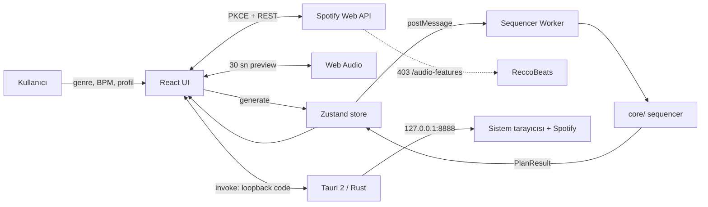
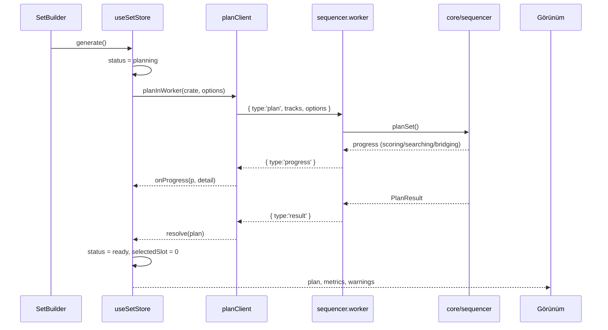
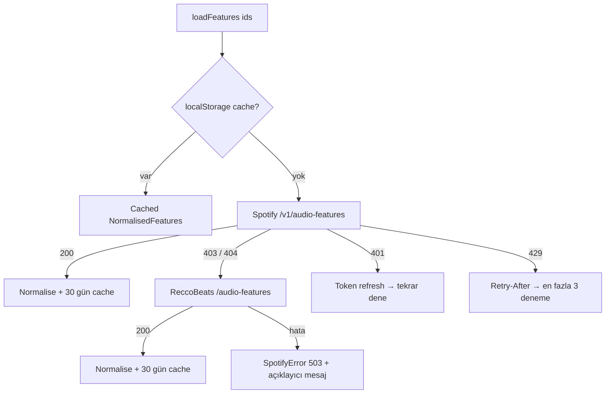
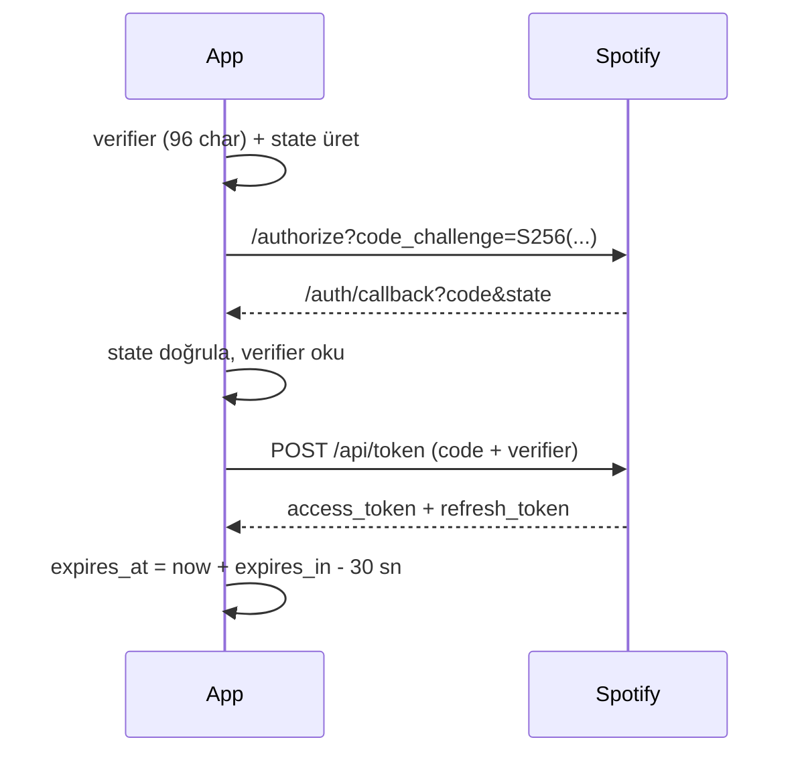

# Harmonic Playlist — Mimari

Bu belge, Harmonic Playlist'in çalışma zamanı mimarisini, veri akışını ve genişletme noktalarını açıklar. Kod örneklerinde dosya yolları `src/` köküne göredir.

---

## 1. Sistem bağlamı



Uygulama **sunucusuz** çalışır. Kalıcı veri yoktur; yalnızca TTL'li `localStorage` önbelleği ve Spotify token'ı tutulur.

### 1.1 Ekranlar ve durum

| View | Dosya | Okuduğu store | Yazdığı store |
| --- | --- | --- | --- |
| Set Builder | `components/builder/SetBuilder.tsx` + wheel/timeline/playlist | `useSetStore` | `options`, `activeGenres` |
| Krate | `components/views/CrateView.tsx` | `allTracks`, `activeGenres`, `plan` | `activeGenres`, `appendTrack` |
| Harmonik Rotalar | `components/views/RoutesView.tsx` | `allTracks`, `options` | `setPlan` |
| Analitik | `components/views/AnalyticsView.tsx` | `plan` | `selectSlot` |

Aktif ekran `useUiStore` içinde tutulur; `1–4` tuşları ve sol ray aynı store'u kullanır. Bu ayrım önemli: **Krate ve Rotalar plan üretmez**, yalnızca mevcut havuzu ve adayları okur — böylece bir ekrandaki geçici filtre diğerini bozmaz.

---

## 2. Katmanlar ve sorumluluklar

| Katman | Dosyalar | Sorumluluk | Bağımlılık |
| --- | --- | --- | --- |
| **Domain çekirdeği** | `core/camelot.ts`, `harmonic.ts`, `bpm.ts`, `energy.ts`, `sequencer.ts`, `types.ts` | Saf fonksiyonlar. UI, React veya DOM bilmez. Test edilebilirliğin temeli. | Yok |
| **Veri sınırı** | `core/track.ts`, `data/mockTracks.ts` | `Track` → `TrackWithKey` dönüşümü; Camelot bir kez burada türetilir. | `core/camelot` |
| **Servisler** | `services/spotify/*`, `services/cache.ts` | OAuth, REST, hata eşleme, önbellek, krate keşfi. | Web API |
| **Orkestrasyon** | `workers/planClient.ts`, `sequencer.worker.ts` | Ağır hesabı ana thread'den ayırır; protokol ve fallback. | `core/sequencer` |
| **Durum** | `state/useSetStore.ts`, `usePlayerStore.ts`, `playback.ts`, `usePlaybackBridge.ts` | UI niyeti ↔ motor sonucu; çalma komutları. | Zustand |
| **Ses** | `audio/previewEngine.ts` | Web Audio grafiği, crossfade, synth fallback, RMS. | Web Audio |
| **Görünüm** | `components/**`, `styles/index.css` | Sunum, etkileşim, animasyon. | React, Tailwind |

**Kural:** `core/` içine React, `window`, `fetch` veya `localStorage` sızmaz. Bu sayede motor Node ortamında test edilebilir ve ileride bir Rust/CLI istemcisine taşınabilir.

---

## 3. Ana veri akışı



### Krate hazırlama

`generate()` içinde `crateFor(allTracks, activeGenres)` çalışır:

- Tür seçilmemişse tüm kütüphane kullanılır.
- Seçili türlerden herhangi birine ait şarkılar alınır.
- Demo modunda `getDemoTracks()` deterministik üreteci devrededir.

### Worker protokolü

`core/types.ts` içinde tanımlıdır:

```ts
// ana thread → worker
{ type: 'plan', requestId: string, tracks: TrackWithKey[], options: SequencingOptions }

// worker → ana thread
{ type: 'progress', requestId, phase: 'scoring'|'searching'|'bridging'|'metrics', progress: 0..1, detail? }
{ type: 'result',   requestId, result: PlanResult }
{ type: 'error',    requestId, message: string }
```

- Her istek `requestId` ile eşleştirilir; eşzamanlı istekler birbirini ezmez.
- Worker çökerse `onerror` tüm bekleyen promise'leri reddeder ve worker'ı sonlandırır; sonraki çağrı yeniden kurar.
- `Worker` yoksa `planSet()` senkron çalışır (Vitest ve kısıtlı webview'ler).

---

## 4. Sıralama algoritması

### 4.1 Havuz filtresi (`preparePool`)

1. Tekrarlanan `id`'ler atılır.
2. Geçersiz/`0` tempo atılır.
3. `speechiness > 0.66` (podcast, spoken word) atılır.
4. İstenen BPM aralığı dışındaki şarkılar atılır.
5. **Peak Time** profilinde tempo penceresi, ağırlıklı medyan etrafında %30 daraltılır — yeterli şarkı kalırsa.

### 4.2 Ön hesaplama

`n = havuz boyutu` olmak üzere dört `Uint8Array` matrisi kurulur:

- `keyScore[i][j]` — anahtar skoru (0–100)
- `keyCompat[i][j]` — 0/1
- `bpmScore[i][j]` — tempo skoru
- `bpmCompat[i][j]` — 0/1

Maliyet `O(n²)`; 200 şarkıda 40.000 hücre, tipik olarak < 10 ms. Ana thread'de yapılsa bile kabul edilebilir, ancak worker'a taşınmıştır.

### 4.3 Açılış seçimi

Enerji uyumu (ağırlık **0.62**) + tempo merkezine yakınlık (**0.38**) + deterministik jitter (`rng() * 0.06`) ile ilk 18 aday sıralanır. `startTrackId` verilmişse yalnızca o şarkı açılış olur.

### 4.4 Beam search

Her adımda:

- Hedef enerji `targets[step]` olur.
- Yönlü profillerde (`steady-climb`, `peak-time`, `sunrise`) enerji koridoru sırayla `0.09 → 0.16 → 0.26 → 0.4 → 1.01` genişletilir. Böylece dar krate'lerde bile set tamamlanır.
- Anahtar eşiği: `20 + strictness * 46`. Varsayılan `0.72` → **53**. Bu, "energy-drop" (70) ve üstünü kabul eder; diyagonal (56) sınırda kalır.
- BPM, istenen aralığın `%6` toleransı dışına çıkamaz.
- Kazanç: `key * 0.42 + bpm * 0.28 + enerji * 0.30` + profil cezaları + sanatçı cooldown + anahtar tekrarı cezası + jitter.

Her beam'den en iyi **6** dal alınır, toplam **18** beam tutulur. Son adımda tam uzunluğa ulaşan en yüksek skorlu yol seçilir.

> Neden greedy değil? Erken bir hatalı seçim, sonraki 30 şarkıyı kilitleyebilir. Neden tam DP değil? `2^n` alt küme uzayı 40 şarkıda bile imkânsızdır. Beam search, kalite ile hesaplanabilirlik arasındaki dengeyi kurar.

### 4.5 Köprüler (`findBridges`)

S ve A dışındaki her `A → B` çifti için, kullanılmayan bir `C` aranır:

- `A → C` uyumlu **ve** `C → B` uyumlu,
- ortalama skor doğrudan geçişten en az **5** puan yüksek.

En iyi 2 seçenek döner. Üretim sırasında en fazla **2** köprü eklenir; istenen uzunluk korunmak için kuyruktan zayıf slot düşürülür.

### 4.6 Enerji hedefinin yeniden ölçeklenmesi (`targetsFor`)

Soyut profil eğrisi (0–1) doğrudan kullanılmaz. Krate'in kendi enerji dağılımından `p8` ve `p92` alınır; eğri `[lo, hi]` aralığına gerilir. Böylece en yüksek enerjisi `0.76` olan bir kütüphane bile "Steady Climb"de gerçek bir yükseliş üretir.

| Profil | Eşleme |
| --- | --- |
| `peak-time` | `lo + span*0.72 + span*0.28*n` |
| `sunrise` | `lo + span*0.92*n` |
| `warm-up` | `lo + span*0.72*n` |
| diğerleri | `lo + span*n` |

### 4.7 Metrikler (`computeMetrics`)

| Metrik | Tanım |
| --- | --- |
| `harmonicPurity` | Uyumlu geçiş yüzdesi |
| `clashRate` | Yarım ton çakışması yüzdesi |
| `averageScore` | Geçiş skorlarının ortalaması |
| `longestCompatibleStreak` | En uzun kesintisiz uyumlu dizi |
| `bpmDrift` | Set içi maksimum − minimum BPM |
| `energyAccuracy` | `1 − ortalama mutlak hata` |
| `keySpread` | Kullanılan farklı anahtar sayısı |
| `gradeCounts` | S/A/B/C/D dağılımı |

---

## 5. Harmonik model

### 5.1 Camelot dönüşümü

Spotify `key` değeri pitch class'tır (`C = 0`), `mode` ise `0 = minör / 1 = majör`.

```ts
// major (B tarafı):  C→8B, C#→3B, D→10B, ...
// minor (A tarafı):  C→5A, C#→12A, D→7A, ...
const number = mode === 1 ? MAJOR_TO_CAMELOT[key] : MINOR_TO_CAMELOT[key];
```

Ters dönüşüm `camelotToSpotify()` ile yapılır; Serato/Rekordbox dışa aktarımı ve testler bunu kullanır.

### 5.2 İlişki skorları

| İlişki | Örnek | Skor | Uyumlu |
| --- | --- | --- | --- |
| `same` | 8A → 8A | 100 | ✅ |
| `adjacent-up` | 8A → 9A | 96 | ✅ |
| `adjacent-down` | 8A → 7A | 94 | ✅ |
| `relative` | 8A → 8B | 90 | ✅ |
| `energy-boost` | 8A → 10A | 74 | ✅ |
| `energy-drop` | 8A → 6A | 70 | ✅ |
| `diagonal` | 8A → 10B | 56 | ✅ (sınır) |
| `mode-shift` | 8A → 9B | 34 | ❌ |
| `clash` | yarım ton | 10 | ❌ |

Ek kurallar:

- Yarım ton (**1 st**) her zaman çakışmadır; çark matematiği ne derse desin.
- Triton (**6 st**) skoru en fazla **26**'ya çapalanır.
- Anahtar bilinmiyorsa skor **50** ve `compatible = true`; kullanıcı metadata eksikliği yüzünden engellenmez.

### 5.3 Geçiş puanı

```
score = key * 0.50 + bpm * 0.32 + energyFit * 0.18
```

| Not | Eşik |
| --- | --- |
| S | ≥ 88 |
| A | ≥ 78 |
| B | ≥ 66 |
| C | ≥ 52 |
| D | < 52 |

`compatible = key.compatible && bpm.compatible`. Enerji uyumu tek başına uyumluluğu bozmaz; sadece notu düşürür.

---

## 6. Sağlayıcı soyutlaması (ses özellikleri)

Ses özellikleri, uygulamanın en kırılgan dış bağımlılığıdır. Bu yüzden tek bir `AudioFeatures` şekli etrafında toplanmıştır (`core/types.ts`):

```ts
interface AudioFeatures {
  energy; danceability; valence; acousticness; speechiness; instrumentalness;
  tempo; key: PitchClass | null; mode: SpotifyMode | null;
  keyConfidence?: number;
  source: 'spotify' | 'reccobeats' | 'local-dsp' | 'manual' | 'demo';
}
```

### 6.1 Sağlayıcı zinciri



- Spotify endpoint'i **403/404** dönerse `null` kabul edilir; bu bir hata değil, bilinen kısıttır.
- ReccoBeats yanıtı Spotify uyumlu alanlara eşlenir; eksik alanlar güvenli varsayılanlara düşer.
- ReccoBeats `id` alanı **kendi UUID'sidir**; Spotify kimliği yalnızca `href` içinde (`open.spotify.com/track/<id>`) gelir. `getReccoFeatures` bu yüzden kimliği `href`'ten çözer — aksi halde özellik haritası hiçbir parçayla eşleşmez ve içe aktarma boş döner.
- Her özellik kaydı `source` alanını taşır. UI bunu güven rozeti olarak gösterebilir.
- **Yerel DSP** (`local-dsp`) henüz uygulanmadı. Arayüz buna hazır: bir sağlayıcı `NormalisedFeatures` ürettiği sürece sequencer değişmez. Planlanan yaklaşım: Web Audio/FFmpeg ile mono 44.1 kHz'e indirgeme → spektral tepe analizi (key) → onset autocorrelation (BPM) → RMS/loudness (energy).

### 6.2 Keşif stratejisi

`/v1/recommendations` kapalı olduğu için krate, tür ifadeleri ve amiral gemisi sanatçılarla tohumlanır:

```ts
'afro-house': ['afro house', 'afro house 2025', 'afro tech',
               'black coffee', 'da capo', 'keinemusik', 'sun-el musician', ...]
```

- Her sorgu için 10 sonuç, **12 saat** önbellek.
- Tekrarlar `Map<id, track>` ile ayıklanır.
- Varsayılan üst sınır 140 şarkı; ardından toplu `GET /tracks` (50'lik parçalar) ve özellik yüklemesi.

---

## 7. Kimlik doğrulama ve güvenlik



- **PKCE zorunlu**: masaüstü uygulaması client secret taşıyamaz.
- **İki OAuth modu** (`src/lib/platform.ts` karar verir):

  | Ortam | Redirect URI | Akış |
  | --- | --- | --- |
  | Tarayıcı (`npm run dev` / deploy) | `http://127.0.0.1:5199/auth/callback` veya `https://app…/auth/callback` | Sayfa Spotify'a gider, callback aynı sekmeye döner, `sessionStorage`'daki verifier okunur |
  | Tauri masaüstü | `http://127.0.0.1:8888/auth/callback` | Rust `oauth_callback_listener` portu dinler; sistem tarayıcısı açılır; kod IPC ile döner; webview hiç yönlenmez, verifier korunur |

  Masaüstünde `checkRedirectConfig()` origin eşleşmesi aramaz — çünkü loopback dinleyicisi webview origin'i ile aynı olmak zorunda değildir. Tarayıcıda bu kontrol zorunludur.
- **`localhost` yasak**: Spotify yalnızca HTTPS veya loopback IP literal (`127.0.0.1` / `[::1]`) kabul eder. Dashboard'a `http://127.0.0.1:5199/auth/callback` girilir; uygulama da aynı origin'den açılmalıdır, aksi halde `sessionStorage`'daki PKCE verifier kaybolur.
- **HTTPS tünel/deploy**: `cloudflared`, ngrok veya statik hosting kullanılıyorsa redirect URI aynı public origin olmalıdır (`https://app.example.com/auth/callback`). Tünel URL'si değişirse dashboard ve `VITE_SPOTIFY_REDIRECT_URI` birlikte güncellenir; quick tunnel yerine sabit domain tercih edilir.
- **Çok kullanıcı**: loopback redirect yalnızca uygulamanın çalıştığı makinede geçerlidir. Merkezi bir deploy'da her kullanıcının callback'i kendi `127.0.0.1`'ine gideceği için public HTTPS redirect zorunludur.
- `verifier` ve `state` `sessionStorage`'da tutulur; sekme kapanınca silinir.
- Token şu an `localStorage`'da (demo). Paketlenmiş sürümde OS keychain'e taşınmalıdır: Tauri `stronghold`, Electron `safeStorage`.
- 401'de bir kez refresh denenir; başarısızsa oturum kapatılır.
- 429'da `Retry-After` okunur, en fazla 8 sn beklenir, 3 denemeyle sınırlanır.
- Hiçbir gizli anahtar repoda tutulmaz; `.env` `.gitignore` kapsamındadır.

### 7.1 Spotify Web API uç nokta değişiklikleri (2025+)

Spotify 2025 sonunda çalma listesi uç noktalarını yeniden adlandırdı; eski yollar **403 Forbidden** dönüyor. İstemci bu yüzden yeni yolları kullanır, eski alanları da okuyarak önbellekteki yanıtlarla uyumlu kalır.

| İşlem | Eski | Yeni | Yanıt farkı |
| --- | --- | --- | --- |
| Liste parçalarını okuma | `GET /playlists/{id}/tracks` | `GET /playlists/{id}/items` | parça `item.track` → `item.item`; `type: 'episode'` podcast'leri gelir |
| Listeye parça ekleme | `POST /playlists/{id}/tracks` | `POST /playlists/{id}/items` | gövde aynı (`{ uris }`) |
| Liste oluşturma | `POST /users/{id}/playlists` | `POST /me/playlists` | gövde aynı |
| Liste parça sayısı | `playlist.tracks.total` | `playlist.items.total` | `tracks` alanı hiç dönmüyor (`null`) |

- `getPlaylistTracks` hem `item.item` hem `item.track` alanını okur; `is_local` ve `type === 'episode'` kayıtları atlanır.
- `normalisePlaylist` parça sayısını `items.total` → `tracks.total` sırasıyla çözer; ikisi de yoksa `trackCount: null` olur ve arayüz "parça sayısı yüklenince belli olur" yazar — `0` göstermek yanıltıcı olurdu.
- Tüm liste alanları normalize edilir; `id`'siz kayıtlar atılır ve modal'ın liste bölümü kendi `SectionBoundary`'si içinde durur, böylece bozuk bir yanıt tüm arayüzü çökertmez.

### 7.2 Başkasının çalma listesi neden açılmıyor

`GET /playlists/{id}/items` dokümanı birebir şunu diyor:

> This endpoint is only accessible for playlists owned by the current user or playlists the user is a collaborator of. A `403 Forbidden` status code will be returned if the user is neither the owner nor a collaborator.

Gerçek hesapla ölçüm (596 liste tarandı):

| Durum | Sonuç |
| --- | --- |
| Kendi listelerim | 40/40 → `200` |
| Başkalarının listeleri (Boiler Room, SSL Music, Bootshaus…) | 10/10 → `403` |
| Liste meta'sı (ad, kapak, sahip, parça sayısı) | `200` ✅ |
| Takip ettikten sonra tekrar | yine `403` |
| `collaborative: true` olan yabancı liste | `200` |

Bu bir uygulama hatası değil, API kuralı; takip etmek, Premium veya quota artırmak değiştirmiyor. Bu yüzden `canReadPlaylistItems(playlist, myUserId)` kararı verir ve modal yabancı satırları **görünür ama kilitli** gösterir (kilit ikonu, `aria-disabled`, tek bir açıklama, kopyalama önerisi). Satıra tıklamak istek atmaz — kullanıcıyı garanti bir 403'e göndermek yerine nedeni gösteriyoruz. Embed sayfasını kazımak ToS ihlali olduğu için yapılmıyor.

---

## 8. Ses grafiği

```text
Spotify previewUrl ──fetch──▶ decodeAudioData ──▶ AudioBufferSourceNode ─┐
iTunes previewUrl  ──fetch──▶ decodeAudioData ──▶ AudioBufferSourceNode ──┤
Demo track ──▶ OscillatorNode ×5 ──▶ BiquadFilter ──▶ GainNode ───────────┤
                ▲ LFO (filter)  ▲ pulse (gain)                            │
                                                                          ▼
                                                        master GainNode ──▶ AnalyserNode ──▶ destination
```

- **Crossfade gerçektir**: eski voice'un gain'i `linearRampToValueAtTime(0.0001, now + fade)` ile sönerken yeni voice `0.0001 → 1` yükselir. Süre varsayılan 4 sn, transport bar'dan ayarlanır.
- **Buffer cache**: en fazla 12 decode edilmiş buffer; FIFO tahliyesi.
- **CORS / süresi dolmuş URL**: fetch veya decode başarısızsa bir sonraki çözümleyici denenir; hepsi başarısızsa synth'e düşer. Çalma asla sessizce ölmez.
- **Synth**: Camelot anahtarı → pitch class → kök frekans. Minörde `[0,3,7,10,12]`, majörde `[0,4,7,11,12]`. Yavaş LFO filtreyi, BPM/2 osilatörü gain'i modüle eder.
- **Meter**: `AnalyserNode.getFloatTimeDomainData` → RMS → `min(1, rms * 3.2)`.
- `AudioContext` yalnızca kullanıcı etkileşiminden sonra `resume()` edilir (tarayıcı politikası).

### 8.1 Önizleme çözümleme zinciri

Spotify `preview_url` alanını Kasım 2024'ten beri üçüncü taraf uygulamalara **`null`** döndürüyor (dokümanda "Deprecated"). Bu yüzden gerçek ses başka bir sağlayıcıdan gelmek zorunda. Sıra:

| # | Kaynak | Eşleşme | Tarayıcıda çalışır? |
| --- | --- | --- | --- |
| 1 | `track.previewUrl` | Spotify'ın verdiği URL | Bazı önbelleklenmiş kayıtlarda |
| 2 | Deezer `GET /track/isrc:{isrc}` | ISRC — birebir kayıt | **Hayır** (CORS başlığı yok) |
| 3 | **iTunes Search** `GET /search?term=…&entity=song&limit=5&country=…` | başlık + sanatçı (katı) | **Evet** (`ACAO: *`) |
| 4 | Deezer `GET /search?q=…` | başlık + sanatçı | Hayır (aynı CORS sorunu) |
| 5 | Synth pad | — | Her zaman |

**Neden Deezer varsayılan kapalı:** `api.deezer.com` yanıtlarında `Access-Control-Allow-Origin` yok. Ölçüm: tarayıcıdan `fetch` → `TypeError: Failed to fetch`; aynı istek `curl` ile 200. Eski kod bu hatayı yutup synth'e düşüyordu, kullanıcı da "neden demo sesi çıkıyor?" diye soruyordu. `setDeezerAvailable(true)` yalnızca CORS'u aşan bir masaüstü proxy'si varsa çağrılmalı.

**Neden iTunes ve neden katı eşleşme:** Apple `lookup?isrc=` parametresini **desteklemiyor** (mainstream ISRC'lerde `resultCount: 0`) ve arama sonuçlarında `isrc` alanı **yok**. Yani ISRC ile doğrulama imkânsız; doğrulama tamamen başlık + sanatçı üzerinde. Yanlış şarkı çalmak synth'ten daha kötü olduğu için kurallar muhafazakâr:

- Sanatçı: birincil sanatçı (ilk ayırıcıya kadar) eşit olmalı; `&`, `,`, `feat.`, `x`, `vs.` ayrıştırılır. "Marten Lou" ≈ "Marten Lou & CamelPhat"; "Taylor Swift" ≠ "Innellea".
- Başlık: parantez/köşeli parantez, `feat.` ve ` - Remix` kuyrukları atılmış çekirdek başlık eşit olmalı (aksan/büyük-küçük harf duyarsız, Türkçe `İ/ı/ş/ğ/ü/ö/ç` katlanır).
- Aday `remix|edit|vip|bootleg|mashup|flip|rework|dub|instrumental|acapella|sped up|slowed` içeriyorsa ve istenen başlık içermiyorsa **reddedilir** (farklı kayıt).
- `kind === 'song'` ve `previewUrl` dolu olmalı.
- Birden fazla geçerli aday varsa ham başlığa tam eşleşme, sonra süre yakınlığı ile sıralanır.

**Ülke:** `VITE_ITUNES_COUNTRY` (varsayılan `TR`). Apple kataloğu mağazaya göre değişir.

**Davranış sözleşmesi:** `playReport()` `{ ok, source: 'spotify'|'isrc'|'itunes'|'search'|'synth', note? }` döner; `playback.ts` bunu `usePlayerStore.audioSource/audioNote`'a yazar. UI kaynağı **her zaman** yazar — sentetik çalarken bunu söylemek opsiyonel değil.

**Önbellek:** pozitif sonuç 7 gün, negatif sonuç 6 saat (`preview:itunes:{country}:{title}|{artist}` anahtarı). Aynı şarkı için eşzamanlı iki çağrı tek istek paylaşır (`inFlight`). Çalma başarısız olursa `markPreviewStale` anahtarı **hemen** geçersiz kılar (TTL `-1`), böylece expired imzalı URL kalıcı "yok" gibi görünmez. "Tekrar dene" `clearPreviewCache` ile aynı şeyi manuel yapar.

---

## 9. Durum yönetimi

### `useSetStore`

| Alan | Açıklama |
| --- | --- |
| `source` | `demo` \| `spotify` |
| `allTracks` | Aktif krate |
| `activeGenres` | Seçili türler |
| `options` | `SequencingOptions` |
| `plan` | `PlanResult \| null` |
| `status` | `idle \| planning \| ready \| error` |
| `progress` / `progressDetail` | Worker ilerlemesi |
| `selectedSlot` | Çark/panellerin odak indeksi |
| `flashIndex` | Sürükle-bırak sonrası vurgu |

Eylemler: `generate`, `toggleGenre`, `patchOptions`, `reorder`, `removeSlot`, `insertBridge`, `selectSlot`, `loadTracks`, `restoreCrate`, `loadDemo`, `reset`.

`loadTracks` gerçek krate'i `crate:last` anahtarına yazar (14 gün). Açılışta `restoreCrate()` bunu geri yükler; demo **yalnızca** kayıtlı krate yoksa devreye girer. Üst çubuktaki `SPOTIFY` rozeti `loadDemo()` ile demo havuza dönüş sağlar.

`reorder` ve `removeSlot`, **yeniden arama yapmaz**; `rebuildPlan()` ile yalnızca geçişleri ve metrikleri yeniden hesaplar. Bu, sürükle-bırakın anında geri bildirim vermesini sağlar.

### `usePlayerStore` + `playback.ts`

UI yalnızca niyet bildirir (`playSlot(index)`, `toggle()`, `seek`). `playback.ts` motoru ve store'u senkronlar; `usePlaybackBridge` 250 ms'lik bir `requestAnimationFrame` döngüsüyle ilerleme çubuğunu ve RMS metre'yi besler.

---

## 10. Hata yönetimi

| Katman | Strateji |
| --- | --- |
| Render | `ErrorBoundary` — Türkçe fallback, "tekrar dene" / "yenile" |
| Async store | `status='error'` + üstte kapatılabilir hata bandı |
| Worker | `onerror` → tüm bekleyen istekler reddedilir, worker yeniden kurulur |
| Spotify 401 | Tek seferlik token refresh |
| Spotify 429 | `Retry-After`, üstel olmayan sabit bekleme, 3 deneme |
| Özellik sağlayıcı | Spotify → ReccoBeats → açıklayıcı 503 |
| Ses | Buffer hatası → synth fallback |
| Boş krate | `NOT_ENOUGH_TRACKS` uyarısı; set küçültülür, çökmez |

---

## 11. Performans notları

- Ağır iş worker'da; ana thread yalnızca React render'ı yapar.
- `Uint8Array` matrisleri bellek ve cache dostudur.
- `CamelotWheel` ve `EnergyTimeline` hesaplamaları `useMemo` ile sabitlenir.
- Timeline yatayda sanallaştırılmaz; 40–80 şarkı için SVG yolu kabul edilebilir. 200+ şarkıda pencereleme gerekir.
- Buffer cache 12 ile sınırlı; uzun setlerde bellek şişmez.
- `prefers-reduced-motion` için animasyonlar CSS'te kapatılabilir (bkz. `styles/index.css`).
